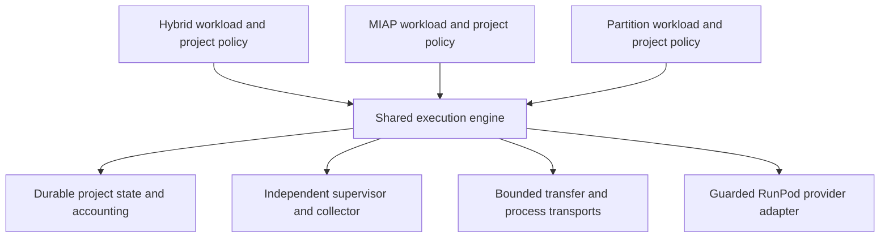

# Unifying the consuming projects

Design study, 2026-11-10. This document proposes the next engineering iterations;
the contracts below are not implemented APIs or authorization for provider use.
The objective is one maintained RunPod execution package used by hybrid-inference,
miap-protocol and partitioned-inference-experiments, so fixes can benefit all three.

## Findings from the current systems

| Consumer | Current integration | Requirements the common package must cover |
| --- | --- | --- |
| Hybrid inference | Uses this package through a pinned sibling checkout; experiment runners still repeat generic orchestration | CPU/GPU stages, interactive binary streams, bounded large-file upload, failed-stage evidence and collection |
| MIAP | Independent provider, ledger, watchdog and transport implementation | Sequential GPU batches, verified block recovery/finalization, source-bound approvals, model access credentials, resource eligibility |
| Partitioned inference | Independent serial controllers plus a reviewed two-Pod coordinator | CPU/GPU selection, parent/child budgets and reservations, exact-run concurrency, direct/proxy SSH, chunked archive transfer, service processes |

These implementations supply requirements and regression cases. Their current
module boundaries and schemas need not become the final shared design. Scientific
protocols and result interpretation remain owned by the consuming projects.

## Target ownership

The shared package should own provider transport, inventory views, mutation
guards, resource planning, durable execution/accounting, supervision, bounded
transport, collection and generic operational evidence. Project code should
supply validated approval evidence, identity/configuration, workload inputs,
permitted transfers, resource eligibility and scientific result verification.

The same code serves each project. Approvals, artifact stores, credentials,
budgets and execution state retain their own ownership and scope. Initially one
authorized controlling host owns each project's canonical state across its local
checkouts. Different projects can use different hosts concurrently. A future
multi-host service requires an actual coordination design; a shared folder or Git
does not provide distributed reservations. Account inventory/funding observation
does not authorize account-wide cleanup or borrowing another project's budget.

## Common contracts to implement

### Provider and ownership

Introduce unambiguous account, project and exact-attempt inventory methods. Today
`RunPodClient.pods()` returns account inventory, while older consumer APIs use
`pods()` for the project view. Compatibility adapters must preserve the old
meaning until callers migrate. Foreign resources never count as project slots or
prove exact-run cleanup. An unknown resource inside the project's namespace
requires reconciliation; name prefixes alone do not establish exact-run authority.

All supported mutations must pass through one guarded execution interface that
checks project, approved request, controlling host, durable attempt claim and live
provider identity. Keep raw transport internal to that interface. Local guards
remain accident prevention for cooperating code, not provider IAM.

Normalize CPU/GPU quotes, actual scheduled shapes, regional availability, bounded
redacted provider errors and exact-Pod billing observations. Distinguish a verified
pre-create rejection from an ambiguous timeout. HTTP status alone is insufficient
to prove that no resource was created. Recheck current offers at create and actual
shape/rate afterward; preserve uncertainty about capacity and delayed billing.

Resource requirements belong in configuration: CPU count/RAM, GPU memory and
capabilities, CUDA/image compatibility, region preference/allowlist, disk, mounts,
ports and finite cost limits. Eligibility rules such as excluding a GPU partition
for a particular workload must not become global bans or project IDs in the core.

### Durable attempts and accounting

Design a versioned project state store that transactionally links approval scope,
host, experiment/round/attempt identities, request/source/config/manifest hashes,
instance reservations, costs and immutable events. The current separate budget
and attempt databases do not express every consumer's envelope or concurrency
contract. Do not change `max_instances=1` to `2` without atomic slot, total and
aggregate-hourly admission checks.

Resource lifecycle and billing are separate dimensions. A terminated attempt can
still have a pending charge. Retain conservative holds for ambiguous operations
and unposted costs; replace or amend them with verified exact-Pod billing evidence
without resetting consumed approvals, double counting or erasing prior events.
Support finite parent/round/child caps and include setup, storage estimates,
transfers where applicable, failed attempts, retries and cleanup. Use integer
microdollars and explicit rounding. These controls cannot guarantee provider bills.

Initial profiles should support serial execution and the required bounded
two-resource profile, each with exact reservations and supervision. Several
logical workload roles may run as processes on one resource; role count is not
Pod count and does not establish isolation from the host or provider.

A candidate lifecycle includes reserved, create-claimed, active, stopping and
terminated, with distinct never-sent cancellation, verified rejection and
ambiguous-operation states. Unknown state blocks new conflicting admission.
Recovery must preserve a returned candidate ID even if the response name differs.

### Approval and workload interfaces

Define an immutable job specification containing project/experiment/attempt IDs,
approved question/boundary references, controller host, artifact/package digests,
resource policy, finite limits, transfer manifests and expected outputs. A project
approval adapter validates its own evidence and supplies the common fields; an
approval-reference string or callback success must not manufacture authorization.

Bind each attempt to its exact package and workload artifacts. Separate the
approved scientific/disclosure scope from renewable finite technical execution
windows, so an ordinary corrective retry can remain within the same authorization
and cumulative cap. Historical exact-card receipts keep their original limits.

Expose bounded workload stages for prepare/install, start, observe, collect and
verify. Project hooks implement model/protocol logic and scientific acceptance;
the engine enforces the surrounding lifecycle. Hooks must not need unrestricted
provider mutation access. Independent output verification and promotion of an
already collected block should be restartable without launching a new resource.

### Supervision and transport

Unify host qualification, detached launch, real interpreter/PID identity,
heartbeat freshness, clock/restart handling, stop latching, telemetry-write
recovery, exact cleanup and provider-confirmed absence. A process-launch flag or
sleep-prevention call is not proof of survival through the controlling tool's exit.
Qualify the deployed launcher on each supported host. Keep supervisor/collection
lifetimes independent of foreground SSH. Record whether provider expiry exists;
do not claim protection from host power loss when it is absent.

Provide one transfer contract with direct SSH first and an explicitly qualified
proxy adapter where required. Cover reviewed small bundles and bounded streaming
files/archives, per-file/aggregate size limits, local and remote hashes, atomic
publication, timed I/O and output limits. Resume requires its own tested integrity
contract. Keep host-key policy explicit; TOFU is not independent authentication.

Use a deliberate ephemeral secret-delivery interface for authorized model access.
Credentials must not enter command diagnostics, argument logs, manifests, bundles,
telemetry or returned artifacts. Preserve private journals and collect permitted
partial/failure artifacts before cleanup whenever possible. A numerical failure
is an experiment outcome; it need not suppress collection or trigger a retry.

## Dependencies and release discipline

Keep the controller core on Python 3.11+ and the standard library where practical.
OpenSSH and any required remote utilities are explicit qualified capabilities.
PyTorch, Transformers, quantization/CUDA packages, numerical and HE runtimes stay
in each workload's pinned environment rather than becoming library dependencies.

Replace sibling `sys.path` imports with installed artifacts pinned by immutable
revision/version and hash in each project's environment. Record the actual loaded
artifact in attempt provenance and in detached subprocess qualification. Preserve
the current base-interpreter/PID fix when changing package installation; a base
Python may not have packages installed in a consumer's virtual environment.

Use schema versions, capability declarations, release notes and compatibility
tests. Publish reviewed releases; update consumers explicitly. A library fix
should gain a central regression plus relevant consumer conformance coverage,
then be adopted by all applicable consumers. Do not silently track a moving
branch or replace code under an active controller.

## Implementation and migration order

1. Define common specifications and build offline contract fixtures from the
   current ownership, recovery, accounting and transport requirements. Record
   which existing entry points and modules each milestone will retire.
2. Normalize provider/inventory/errors/billing and packaging, preserving legacy
   API meanings behind thin temporary adapters. Adopt these in the existing
   hybrid integration and one new serial consumer path.
3. Implement the common durable store, supervision and serial execution engine;
   qualify MIAP's sequential workload and partition's serial CPU/GPU workload with
   fake providers and independently verified outputs.
4. Move generic streaming/proxy transport and restartable collection/recovery
   into the library. Simplify hybrid's repeated runner stages against the same
   engine and preserve its interactive workload interface.
5. Implement and qualify the bounded parallel profile with atomic parent/child
   reservations. Move partition's dispatcher onto it after serial parity passes.
6. Use each new path in an appropriately authorized bounded live qualification,
   then retire duplicate operational code and update the consumer instructions,
   manifests, source bindings and controlling-host deployment records together.

Use existing generic code after interface, source and disclosure review; extract
only what the contract needs. A temporary adapter must delegate common behavior
and have a removal criterion. Historical receipts, reports and source revisions
remain reproducible; retaining history does not require maintaining every old
launcher as an alternative production backend.

## Acceptance and retirement gates

Offline tests must cover sibling-Pod isolation, wrong host, changed source or
request, duplicate concurrent creates, slot/parent-budget races, clock changes,
stale supervisor, ambiguous responses, definitive rejections, restart, failed
telemetry/ledger writes, missing/adjusted bills, corrupt or oversized transfers,
stalled pipes, partial artifacts, failed scientific gates and idempotent recovery.
Test environments must deny accidental live-provider access, including child
processes, without relying solely on a patch of one imported factory.

Consumer tests retain scientific acceptance and run against the proposed common
engine. Passing tests for the independent old stacks is a baseline, not evidence
of integrated parity. Live qualification separately checks host persistence,
direct/proxy connectivity where needed, exact artifacts and provider termination.

At cutover reconcile existing controllers, resources, attempts and pending bills.
Do not rewrite live legacy state in place. Preserve a read-only archive and use
an evidence-checked migration/bridge only where the same approved envelope must
continue; otherwise a new experiment has its own cap and historical bills remain
attached to their original approvals. A rollback must not activate two controllers
or discard outstanding commitments. Remove a duplicate module only after every
active caller, safety check, source binding and deployment instruction has moved.

## Scope of this iteration

The 2026-11-10 iteration is a local architecture and capability study. Runtime
controllers, scientific protocols and live resources were not migrated. Proposed
interfaces and planned validation require implementation before operational use.
